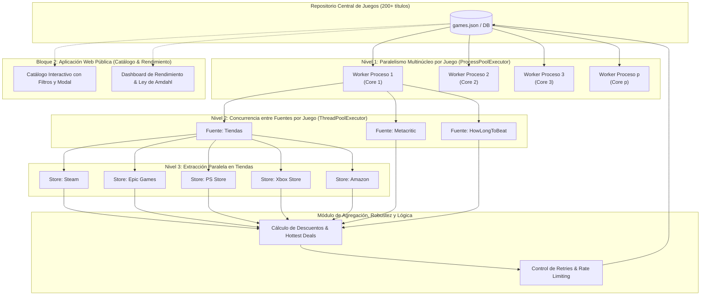

# Diagrama y Documentación de Arquitectura Multinúcleo de 3 Niveles
## IC3101 Arquitectura de Computadoras — III Proyecto: Web Scraping Multinúcleo
**Instituto Tecnológico de Costa Rica — Campus San Carlos**

---

## 1. Visión General de la Arquitectura

Para abordar el desafío de extraer, consolidar y procesar datos de más de 200 videojuegos a partir de múltiples fuentes heterogéneas en la web, el sistema implementa una **Arquitectura Jerárquica de Paralelismo y Concurrencia en 3 Niveles**.

Esta separación por capas desacopla las responsabilidades, optimiza la utilización de los recursos de hardware (núcleos de CPU y ancho de banda de red) y garantiza tolerancia a fallos.

---

## 2. Desglose Detallado de los 3 Niveles

### 2.1 Nivel 1: Paralelismo Multinúcleo de Juegos (Particionamiento Grueso)
* **Responsable:** Kevin (Bloque 1) con integración a Adrián (Bloque 2).
* **Mecanismo:** Procesamiento multiproceso (`multiprocessing` / `ProcessPoolExecutor`).
* **Concepto:** Cada juego del catálogo (más de 200 títulos en el REPO) es una entidad autónoma sin dependencia temporal ni de estado con respecto a los otros juegos (*Embarrassingly Parallel*).
* **Asignación de Recursos:** Se levanta un pool de $p$ trabajadores (donde $p$ coincide con los núcleos lógicos del microprocesador: 1, 2, 4, 8 cores). Cada trabajador toma un lote contiguo o dinámico de juegos y los procesa de manera completamente aislada, evitando el bloqueo del GIL (*Global Interpreter Lock*) de Python.

### 2.2 Nivel 2: Concurrencia entre Fuentes por Juego (Particionamiento Medio)
* **Responsable:** Kevin (Bloque 1).
* **Mecanismo:** Multihilo asíncrono (`ThreadPoolExecutor` o `asyncio`).
* **Concepto:** Para un único juego asignado a un trabajador de Nivel 1, la extracción de información involucra tres fuentes externas independientes:
  1. **Tiendas de venta** (precios, formatos, plataformas, stock).
  2. **Metacritic** (Metascore de críticos y User Score).
  3. **HowLongToBeat** (horas estimadas de historia principal, extras y completista).
* **Ventaja de Rendimiento:** En lugar de realizar estas peticiones en serie ($T_{total} = T_{tiendas} + T_{metacritic} + T_{hltb} \approx 600\text{ms}$), se disparan concurrentemente, reduciendo el tiempo total al máximo entre las fuentes ($T_{total} = \max(T_{fuentes}) \approx 200\text{ms}$).

### 2.3 Nivel 3: Extracción Paralela en Tiendas (Particionamiento Fino)
* **Responsable:** Kevin (Bloque 1).
* **Mecanismo:** Extracción concurrente sobre al menos dos plataformas de venta simultáneas.
* **Tiendas Soportadas:** Steam, Epic Games Store, PlayStation Store, Xbox Store, Nintendo eShop, Amazon y GOG.
* **Datos Extraídos por Tienda:**
  * Precio actual de oferta.
  * Precio regular de lista.
  * Formato (Digital o Físico).
  * Plataforma soportada (PC, PS5, Xbox Series X/S, Switch).
  * Enlace directo a la tienda.
  * Disponibilidad de stock.

---

## 3. Módulo de Lógica, Robustez y Agregación

Una vez que los hilos del Nivel 3 completan la recolección:
1. **Detección de "Hottest Deals":**
   $$\% \text{ Descuento} = \left( 1 - \frac{\text{Precio Actual}}{\text{Precio Regular}} \right) \times 100$$
   Se etiqueta como oferta destacada (*Super Deal*) cuando el descuento supera el $50\%$.
2. **Identificación de la Mejor Oferta:** Se compara el precio actual entre todas las tiendas donde se encuentra el juego y se define `best_deal` con el precio mínimo garantizado.
3. **Mecanismo Anti-Bloqueo:**
   * Rotación de cabeceras `User-Agent`.
   * Gestión de reintentos exponenciales (*Exponential Backoff*) con pausas aleatorias de 250ms a 800ms ante códigos de estado HTTP 429 (Too Many Requests).
4. **Persistencia Dinámica:** Exportación de los datos estructurados en `web/data/games.json` o subida automática a base de datos para consumo del frontend.

---

## 4. Conexión con el Bloque 2 (Frontend y Evaluación de Rendimiento)

La interfaz web creada por Adrián en el Bloque 2 actúa como la cara pública y herramienta de validación técnica del proyecto:
1. **Consumo Reactivo:** Carga inmediata mediante `fetch()` con soporte automático para arrastrar nuevos archivos JSON generados por el scraper.
2. **Filtros Multidimensionales:** Permite al usuario final filtrar por formato (digital/físico), plataforma y tienda, además de ordenar por porcentaje de descuento, precio o score.
3. **Evaluación Experimental:** Incluye un panel interactivo con Chart.js para contrastar las curvas de Speedup y Eficiencia calculadas durante la ejecución real de la arquitectura multinúcleo.
