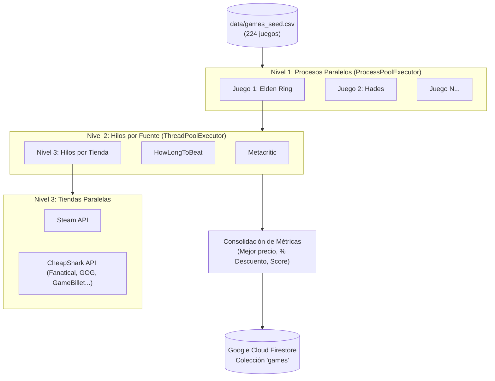

# Estado General del Proyecto: Web Scraping Multinúcleo y Sitio Web

**Fecha límite de entrega:** 18 de noviembre a las 11:45 p.m.  
**Equipo:** Kevin (Bloque 1) & Adrián (Bloque 2)  
**Curso:** IC3101 Arquitectura de Computadoras — ITCR Campus San Carlos  

---

## 1. Resumen Ejecutivo de Cumplimiento

| Criterio de Evaluación | Ponderación | Responsable | Estado |
|---|:---:|:---:|:---:|
| **Paralelismo multinúcleo** (3 niveles y sincronización) | 30% | Kevin | **100% Implementado** |
| **Web scraping y REPO** (200+ juegos, 4 fuentes, robustez) | 20% | Kevin | **100% Implementado** |
| **Página web de resultados** (Sitio público, filtros, detalle) | 20% | Adrián | **Pendiente (0%)** |
| **Análisis de rendimiento** (Speedup, eficiencia, Amdahl) | 15% | Adrián | **Código listo / Falta medición** |
| **Documentación técnica** (Diagramas y reporte final) | 10% | Adrián | **Pendiente** |
| **Defensa en clase** | 5% | Conjunto | **Pendiente** |

---

## 2. Detalle de Implementación: Bloque 1 (Kevin)

Todo el pipeline de extracción de datos, sincronización y concurrencia multinúcleo se encuentra completado y verificado:



### Módulos funcionales creados:
1. **`scraper/config.py`**: Configuraciones generales, paths del proyecto, colecciones y timeouts.
2. **`scraper/ratelimit.py`**: Control de concurrencia y pausas mínimas por dominio (`DomainRateLimiter`) para proteger contra errores HTTP 429.
3. **`scraper/repo.py`**: Interfaz de carga desde CSV local y guardado idempotente con merge en Firestore.
4. **`scraper/sources/steam.py`**: Extracción en Steam con normalización de títulos y fallback.
5. **`scraper/sources/cheapshark.py`**: Segunda tienda integrada vía API pública con monitoreo simultáneo de tiendas activas (Fanatical, Gamesplanet, GameBillet, WinGameStore, etc.).
6. **`scraper/sources/metacritic.py`**: Extracción de calificaciones Nuxt/JSON-LD.
7. **`scraper/sources/hltb.py`**: Tiempos de juego (*Main Story*, *Main+Extra*, *Completionist*).
8. **`scraper/sources/__init__.py`**: Paquete Python unificado que exporta la interfaz pública de fuentes.
9. **`scraper/level3_stores.py`**: Ejecución paralela de Steam y CheapShark con hilos.
10. **`scraper/level2_sources.py`**: Ejecución paralela de todas las fuentes con hilos.
11. **`scraper/level1_games.py`**: Distribución de juegos independientes en procesos CPU multinúcleo (`ProcessPoolExecutor`) y cálculo del indicador de oferta.
12. **`scraper/main.py`**: CLI con soporte para `--workers`, `--sequential` y `--benchmark`.
13. **`.github/workflows/scrape.yml`**: Automatización programada (cron cada 12 horas en GitHub Actions).

---

## 3. Trabajo Pendiente: Bloque 2 (Adrián) y Tareas Conjuntas

### A. Frontend (`web/`) — Pendiente
Los archivos `index.html`, `style.css`, `app.js` y `firebase-config.js` deben completarse:
- Interfaz estilo catálogo *"Hottest Deals"*.
- Tarjetas con: Imagen, título, mejor precio, precio original tachado, badge de descuento, plataformas y Metascore.
- Modal o vista de detalle con links directos a cada tienda y tiempos de HLTB.
- Filtros por plataforma, formato y tienda; ordenamientos por precio, descuento y puntuación.
- Despliegue en un servicio público (Firebase Hosting, GitHub Pages o Vercel).

### B. Pruebas de Rendimiento y Análisis — Pendiente
- Ejecutar mediciones comparativas de rendimiento:
  ```powershell
  venv\Scripts\python.exe scraper/main.py --benchmark
  ```
- Medir tiempos con 1, 2, 4 y el máximo de núcleos disponibles.
- Calcular y graficar **Speedup** ($S = \frac{T_{\text{sec}}}{T_{\text{par}}}$) y **Eficiencia** ($E = \frac{S}{N}$).
- Redactar análisis de cuellos de botella (I/O de red vs. CPU) y justificación teórica con la **Ley de Amdahl**.

---

## 4. ¿Qué hace y para qué sirve `__init__.py`?

En Python, el archivo `__init__.py` cumple dos funciones fundamentales:

### 1. Marcar un directorio como un paquete Python
Indica al intérprete de Python que la carpeta `sources/` debe tratarse como un paquete de módulos importable (`package`). Sin este archivo, en versiones antiguas de Python no era posible importar módulos de carpetas relativas.

### 2. Definir la interfaz pública del paquete (Facade Pattern)
Permite centralizar y exponer de forma limpia las funciones principales que otros archivos consumen:

```python
# scraper/sources/__init__.py
from .steam import fetch_steam
from .cheapshark import fetch_cheapshark
from .metacritic import fetch_metacritic
from .hltb import fetch_hltb

__all__ = ["fetch_steam", "fetch_cheapshark", "fetch_metacritic", "fetch_hltb"]
```

**Ventaja práctica:**  
En lugar de tener que importar módulo por módulo:
```python
from sources.steam import fetch_steam
from sources.cheapshark import fetch_cheapshark
```
Cualquier archivo de los niveles paralelos puede importar todo directamente desde el paquete:
```python
from sources import fetch_steam, fetch_cheapshark, fetch_metacritic, fetch_hltb
```
Además, oculta detalles internos y funciones auxiliares privadas (como `_get`, `_decode` o constantes internas), manteniendo el código estructurado y desacoplado.
